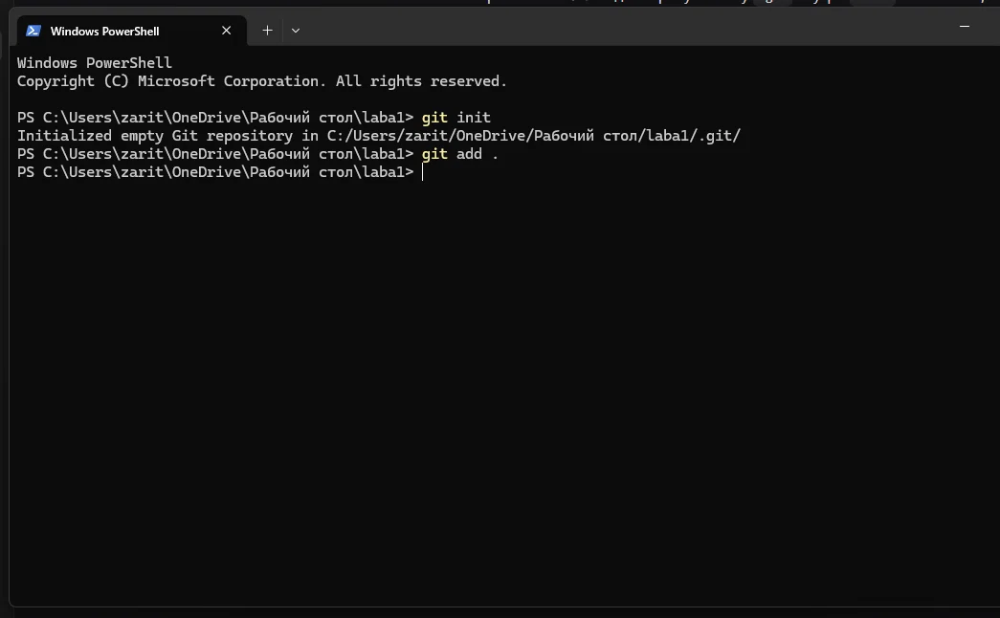
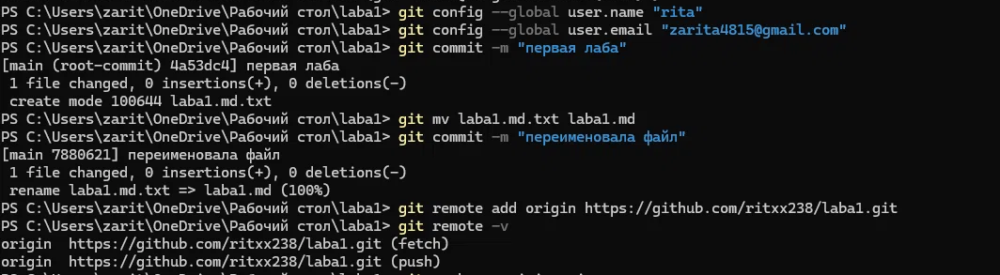
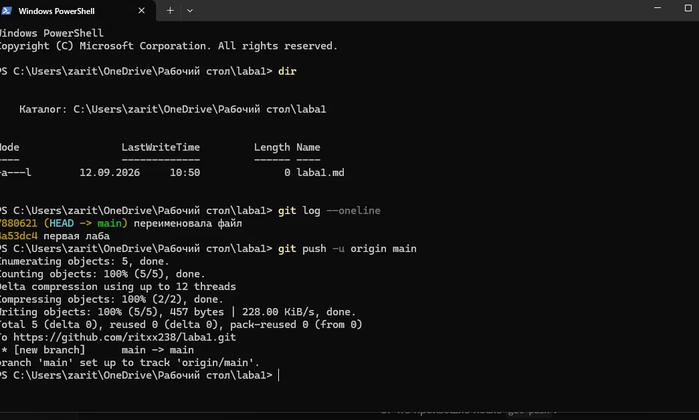

# Лаба 1 — Git

## Что нужно было сделать
1. Создать репозиторий
2. Сделать коммит
3. Добавить удалённый репозиторий
4. Запушить локальные коммиты в удалённый репозиторий

## 1. Создание репозитория и добавление файлов

Выполнила:
- `git init` — создала локальный репозиторий
- `git add .` — добавила файлы

## 2. Коммит и добавление удалённого репозитория

Выполнила:
- `git config --global user.name` / `user.email` — представилась
- `git commit -m "первая лаба"` — сделала коммит
- `git remote add origin https://github.com/ritxx238/laba1.git` — связала с GitHub

## 3. Пуш в удалённый репозиторий

Выполнила:
- `git push -u origin main` — отправила коммиты на GitHub

## Результат

Ссылка на репозиторий: https://github.com/ritxx238/laba1